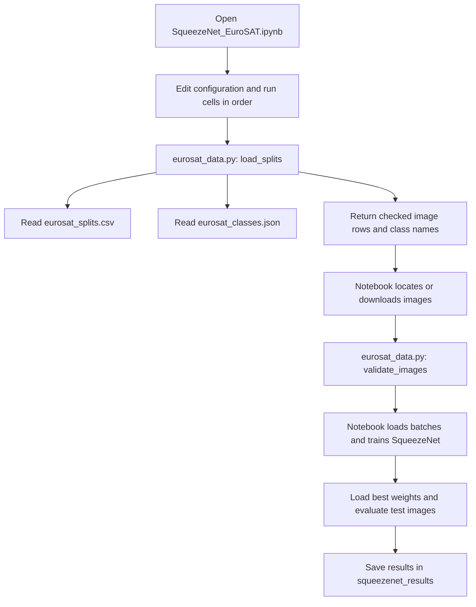

# EuroSAT image classification with SqueezeNet

This project teaches a SqueezeNet 1.1 neural network to identify the type of land
shown in a satellite image. It uses the EuroSAT RGB dataset, which contains
27,000 colour images across 10 classes, such as forests, rivers, residential
areas, and farmland.

Run the cells in `SqueezeNet_EuroSAT.ipynb` to train the model, test it, and save
the results.

## What each file does

| File | Purpose | How it is used |
| --- | --- | --- |
| `SqueezeNet_EuroSAT.ipynb` | The main notebook. Loads images, prepares the model, trains it, evaluates it, and saves results. | Open in Jupyter or VS Code and run the cells in order. |
| `eurosat_data.py` | Provides functions that check the dataset lists and confirm that the image files exist. | Imported by the main program and the tests. You do not need to run it separately. |
| `eurosat_splits.csv` | Lists each image's relative path, class number, and assigned group: training, validation, or testing. | Read by `load_splits()` in `eurosat_data.py`. |
| `eurosat_classes.json` | Lists the 10 class names in label order. Position 0 means `AnnualCrop`, position 1 means `Forest`, and so on. | Read by `load_splits()` to match class numbers to names. |
| `requirements.txt` | Lists the Python libraries needed, including PyTorch, Torchvision, Pandas, and Matplotlib. | Read by `pip` when you install dependencies. |
| `tests/test_splits.py` | Checks the shared data helper. Tests cover image counts, labels, duplicate paths, invalid paths, class order, and missing images. | Run separately with Python's test runner. |
| `.gitignore` | Tells Git to leave out local files such as downloaded data, saved weights, results, and Python cache files. | Used automatically by Git. |
| `.gitattributes` | Controls how Git handles line endings and preserves the original CSV and JSON data files. | Used automatically by Git. |
| `README.md` | Explains the project, commands, files, and execution flow. | Read this to understand and run the project. |

The CSV and JSON files contain information about the images; the image files
themselves must be downloaded or supplied separately.

## How the images are divided

| Group | Images | Purpose |
| --- | ---: | --- |
| Training (`train`) | 18,900 | Used to teach the model. |
| Validation (`val`) | 4,050 | Used after each training round to check progress and choose the best saved model. |
| Testing (`test`) | 4,050 | Used once after training to measure the selected model's performance. |

These groups are already defined in `eurosat_splits.csv`. The program does not
create a new random split. Keep this file and the class order unchanged when
comparing different models, so they all use the same images and labels.

## How to run the project

Open a terminal in the project folder. Install the required libraries in your
Python environment:

```sh
python -m pip install -r requirements.txt
```

Launch Jupyter from the project folder:

```sh
python -m notebook SqueezeNet_EuroSAT.ipynb
```

Alternatively, open `SqueezeNet_EuroSAT.ipynb` in VS Code with Jupyter support.
Select the Python environment where you installed the requirements.

Edit the notebook's **Configuration** cell before running it. If you already
have the images, set the `data_dir` entry to the folder containing the 10 class
folders. For example, on Windows:

```python
data_dir=Path("C:/datasets/EuroSAT"),
```

That folder should contain paths such as `AnnualCrop/AnnualCrop_1.jpg` and
`Forest/Forest_1.jpg`, matching the entries in the CSV. Leave `data_dir=None` to
download `apollo2506/eurosat-dataset` using KaggleHub. The notebook also
downloads the pretrained model weights on first use, so internet access is needed
for these downloads. It uses a CUDA GPU when available; otherwise, it uses the CPU.

Run all cells from top to bottom. The kernel should start in the repository
folder; otherwise, set `ROOT` in the configuration cell to that folder.

The default run uses batches of 64 images, a random seed of 42, and 25 training
rounds in total. A training round is called an **epoch**.

For a shorter trial run, change these entries in the configuration cell:

```python
head_epochs=1,
fine_tune_epochs=1,
output_dir=ROOT / "trial_results",
```

This still uses all the listed images, but trains for only two epochs. Keep
`num_workers=0` for notebook compatibility, particularly on Windows.
Choose a different `output_dir` for each experiment to keep its results separate.
The configuration cell also exposes the split and class files, seed, batch size,
and plot display setting. Restart the kernel and run all cells for a fresh
experiment; re-running a training cell continues the current model and history.

To check the data-handling code separately:

```sh
python -m unittest discover -s tests -v
```

These tests do not train the model or download images.

## Where the results go

By default, the program writes its output to `squeezenet_results/`.

| Output file | What it contains |
| --- | --- |
| `squeezenet_best_state.pt` | The model weights with the lowest validation loss. Loss measures prediction error; lower is better. |
| `training_history.csv` | Training and validation loss, accuracy, and time for each epoch. |
| `training_curves.png` | Graphs showing how loss and accuracy changed during training. |
| `classification_report.csv` | Performance measures for each class, including precision, recall, and F1 score. |
| `test_predictions.csv` | Each test image's path, correct label, and predicted label and class name. |
| `confusion_matrix.csv` and `confusion_matrix.png` | A table and image showing which classes the model predicted correctly or confused with other classes. |
| `model_summary.csv` and `model_summary.json` | Overall test scores, model size, parameter count, timing, and information identifying the input split files. |
| `class_names.json` | The class names used in this run. |
| `eurosat_splits.csv` | A saved copy of the image assignments used in this run. |

Plots are saved automatically and displayed in the notebook by default. Set
`show_plots=False` before starting a fresh run to save them without displaying them.

## How the program flows and how the files call each other

The notebook cells control the whole training run. They import functions from
`eurosat_data.py`; the CSV and JSON files are read as data, not executed as programs.



The calls happen in this order:

1. **Configure the notebook.** The configuration cell stores settings in `args`.
   The next cell imports libraries, seeds random generators, selects the device,
   and creates the output directory.
2. **Read and check the image list.** The data cell calls `load_splits()` from
   `eurosat_data.py`. This function reads the CSV and JSON, checks counts, paths,
   labels, and class coverage, then returns the image rows and class names.
3. **Find the actual images.** The notebook uses your `data_dir` or downloads the
   dataset. It calls `validate_images()` from `eurosat_data.py` to check that all
   listed files exist. A missing file stops the run with an error.
4. **Prepare image batches.** The notebook creates three `EuroSATDataset`
   objects, one for each group. PyTorch's `DataLoader` calls each dataset's
   `__getitem__()` method to open images, convert them to RGB, resize them to
   64 by 64 pixels, and scale their values using ImageNet normalization.
   Training batches are shuffled; validation and test batches keep their order.
5. **Prepare SqueezeNet.** The model cell loads a model already trained on ImageNet
   and replaces its final classifier with one that predicts the 10 EuroSAT classes.
6. **Train the new classifier.** The classifier training cell calls `fit_stage()`
   function for 5 epochs. Only the new classifier learns during this stage.
   Each epoch, `fit_stage()` calls `run_epoch()` for training and again for
   validation. It records progress and saves weights when validation loss improves.
7. **Fine-tune the full model.** The fine-tuning cell reloads the best classifier-stage
   weights and allows the earlier layers to learn too. It calls `fit_stage()`
   again for 20 epochs, using smaller learning rates. The best weights are chosen
   by the lowest validation loss across both stages.
8. **Evaluate and save.** The evaluation cells reload the best
   weights, evaluate the test images once, and save predictions, scores,
   charts, and summary files. The run then finishes.

The test command follows a separate path: Python's `unittest` runner loads
`tests/test_splits.py`, which imports and calls `load_splits()` and
`validate_images()` from `eurosat_data.py`. It does not execute the notebook.
