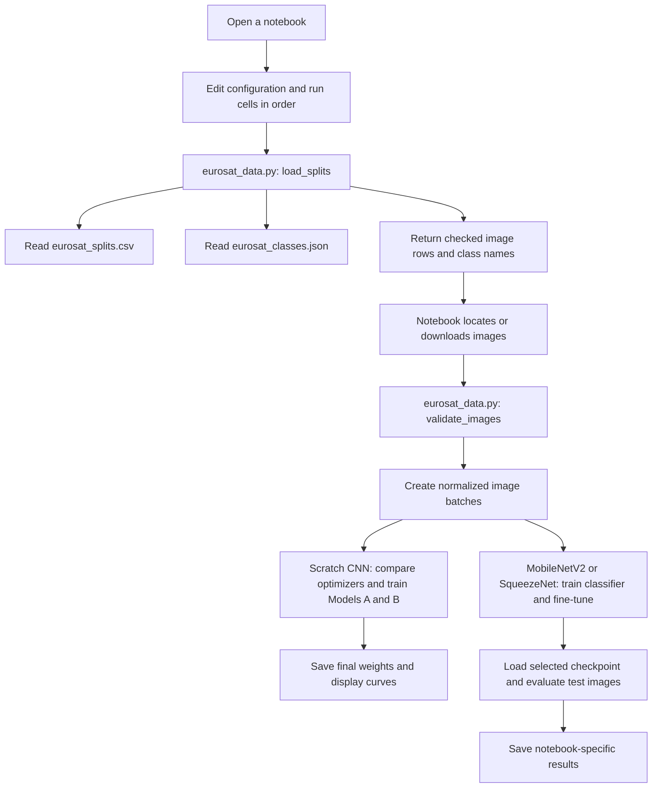

# EuroSAT image classification with CNNs

This project compares CNNs trained from scratch with pretrained MobileNetV2 and
SqueezeNet 1.1 models to identify the type of land shown in a satellite image.
It uses PyTorch and the EuroSAT RGB dataset, which contains
27,000 colour images across 10 classes, such as forests, rivers, residential
areas, and farmland.

The three notebooks share the same image assignments and 64 x 64 RGB
preprocessing. Run each notebook's cells in order in its own kernel.

## What each file does

| File | Purpose | How it is used |
| --- | --- | --- |
| [CNN_EuroSAT_From_Scratch.ipynb](CNN_EuroSAT_From_Scratch.ipynb) | Builds standard and lightweight CNNs, compares optimizers, trains both models, and saves final weights. | Open in Jupyter or VS Code and run the cells in order. |
| [MobileNetV2FineTunning.ipynb](MobileNetV2FineTunning.ipynb) | Trains a pretrained MobileNetV2 classifier, selectively fine-tunes parameters, evaluates the selected checkpoint, and exports a summary. | Open in Jupyter or VS Code and run the cells in order. |
| [SqueezeNet_EuroSAT.ipynb](SqueezeNet_EuroSAT.ipynb) | Trains a pretrained SqueezeNet classifier, fine-tunes the full model, evaluates the selected checkpoint, and exports results. | Open in Jupyter or VS Code and run the cells in order. |
| `eurosat_data.py` | Provides functions that check the dataset lists and confirm that the image files exist. | Imported by all three notebooks and the tests. You do not need to run it separately. |
| `eurosat_splits.csv` | Lists each image's relative path, class number, and assigned group: training, validation, or testing. | Read by `load_splits()` in `eurosat_data.py`. |
| `eurosat_classes.json` | Lists the 10 class names in label order. Position 0 means `AnnualCrop`, position 1 means `Forest`, and so on. | Read by `load_splits()` to match class numbers to names. |
| `requirements.txt` | Lists the Python libraries needed, including PyTorch, Torchvision, Pandas, and Matplotlib. | Read by `pip` when you install dependencies. |
| `tests/test_splits.py` | Checks the shared data helper. Tests cover image counts, labels, duplicate paths, invalid paths, class order, and missing images. | Run separately with Python's test runner. |
| `.gitignore` | Tells Git to leave out local files such as downloaded data, saved weights, results, and Python cache files. | Used automatically by Git. |
| `.gitattributes` | Controls how Git handles line endings and preserves the original CSV and JSON data files. | Used automatically by Git. |
| `README.md` | Explains the project, commands, files, and execution flow. | Read this to understand and run the project. |

The CSV and JSON files contain information about the images; the image files
themselves must be downloaded or supplied separately.

## Models and training workflows

### CNNs trained from scratch

`CNN_EuroSAT_From_Scratch.ipynb` implements two models:

- **Model A: standard CNN.** Three blocks of 3 x 3 convolution, batch
  normalization, ReLU, and max pooling, with 32, 64, and 128 output channels.
  Global average pooling feeds a 64-unit dense layer, ReLU, dropout of 0.3,
  and a 10-class output. It has **102,378 learned parameters**. The notebook
  additionally counts 448 batch normalization running statistics, reporting
  102,826 values when those buffers are included.
- **Model B: lightweight CNN.** Uses depthwise 3 x 3 and pointwise 1 x 1
  convolutions with the same channel widths and classifier structure. It has
  **20,581 learned parameters**, below the notebook's 100,000-parameter limit.

Both models output logits and use cross-entropy loss. The optimizer study
trains fresh copies of Model B from identical initial weights for **7 epochs
each**, comparing Adam (`lr=0.001`), SGD (`lr=0.01`), and SGD with momentum
(`lr=0.01`, `momentum=0.9`). It displays validation curves and a comparison table.

The subsequent training cells create fresh Models A and B and train each for
**20 epochs** with Adam at `lr=0.001`. They save the final epoch's weights and
display training curves. The notebook creates a test loader, but currently has
no test evaluation or best-validation checkpoint selection for these models.

### MobileNetV2 transfer learning

`MobileNetV2FineTunning.ipynb` loads torchvision's default ImageNet-pretrained
MobileNetV2 weights and replaces the classifier with dropout of 0.3 and a
10-class linear layer. It has **2,236,682 parameters**, with **12,810** initially
trainable.

1. Train the classifier for **5 epochs** with Adam at `lr=0.001`, keeping
   feature extractor parameters frozen.
2. Fine-tune for **15 epochs** with Adam at `lr=0.00001`. The code enables
   gradients for the last **30 parameter tensors** in `model.parameters()`.
   Despite its name, `FINE_TUNE_LAST_N_LAYERS` counts parameter tensors, not
   layers. The recorded run has 1,384,330 trainable parameters in this stage.
3. Reload the checkpoint with the lowest validation loss **during stage 2**,
   evaluate the test set, display curves, a confusion matrix, and a per-class
   report, and export a results CSV.

The CSV's `Trainable Parameters` field describes the rebuilt evaluation model
(12,810), rather than the number trained during fine-tuning.

### SqueezeNet transfer learning

`SqueezeNet_EuroSAT.ipynb` uses ImageNet-pretrained SqueezeNet 1.1 with a
replacement 10-class classifier. It has **727,626 parameters**, with **5,130**
initially trainable. It trains the classifier for **5 epochs** with Adam at
`lr=0.001`, then reloads the best classifier-stage checkpoint and fine-tunes
the full model for **20 epochs**. Fine-tuning uses `lr=0.00001` for the features
and `lr=0.0001` for the classifier. Test evaluation uses the lowest-validation-loss
checkpoint **across both stages**.

## How the images are divided

| Group | Images | Purpose |
| --- | ---: | --- |
| Training (`train`) | 18,900 | Used to teach the model. |
| Validation (`val`) | 4,050 | Tracks training progress and optimizer performance; selects checkpoints in MobileNetV2 and SqueezeNet. |
| Testing (`test`) | 4,050 | Measures the selected MobileNetV2 and SqueezeNet checkpoints; not yet evaluated by the scratch CNN notebook. |

These groups are already defined in `eurosat_splits.csv`. The program does not
create a new random split. Keep this file and the class order unchanged when
comparing different models, so they all use the same images and labels.

All notebooks convert images to RGB, resize them to 64 x 64, convert them to
tensors, and apply ImageNet normalization: mean `[0.485, 0.456, 0.406]` and
standard deviation `[0.229, 0.224, 0.225]`. Training batches are shuffled;
validation and test batches keep their order.

## How to run the project

Open a terminal in the project folder. Install the required libraries in your
Python environment:

```sh
python -m pip install -r requirements.txt
```

Launch Jupyter from the project folder, then open any of the three notebooks:

```sh
python -m notebook
```

Alternatively, open your chosen notebook in VS Code with Jupyter support.
Select the Python environment where you installed the requirements.

Edit the **Configuration** cell in the scratch CNN or SqueezeNet notebook, or
**4. Dataset Loading** in MobileNetV2, before running it. If you already
have the images, set the `data_dir` entry to the folder containing the 10 class
folders. For example, on Windows:

```python
data_dir=Path("C:/datasets/EuroSAT"),
```

That folder should contain paths such as `AnnualCrop/AnnualCrop_1.jpg` and
`Forest/Forest_1.jpg`, matching the entries in the CSV. Leave `data_dir=None` to
download `apollo2506/eurosat-dataset` using KaggleHub. MobileNetV2 and SqueezeNet
also download pretrained model weights on first use, so internet access is needed
for these downloads. All notebooks use CUDA when available. The scratch CNN
notebook also supports Apple MPS before falling back to CPU; the other two use
CPU when CUDA is unavailable.

Run all cells from top to bottom. The kernel should start in the repository
folder; otherwise, set `ROOT` to that folder before its validation check.
Scratch CNN and MobileNetV2 output paths remain relative to the kernel's working
directory even when `ROOT` is changed.

### Training settings and short trial runs

| Notebook | Default batch size | Settings for a short trial |
| --- | ---: | --- |
| Scratch CNN | 64 | Set `EPOCHS_TUNE=1` in the optimizer study and `EPOCHS=1` before training Models A and B. |
| MobileNetV2 | 32 | Set `INITIAL_EPOCHS=1` and `FINE_TUNE_EPOCHS=1` in the two training-stage cells. |
| SqueezeNet | 64 | Set `head_epochs=1` and `fine_tune_epochs=1` in the configuration cell. |

A training round is called an **epoch**. These settings shorten training while
still using all listed images. For SqueezeNet, the configuration entries are:

```python
head_epochs=1,
fine_tune_epochs=1,
output_dir=ROOT / "trial_results",
```

Keep `num_workers=0` for notebook compatibility, particularly on Windows.
SqueezeNet exposes `output_dir`, `seed` (default 42), and `show_plots` in its
configuration. MobileNetV2 sets `RANDOM_SEED=42` in its reproducibility cell.
The scratch CNN seeds the training loader and optimizer-study initializations
with 42. Restart the kernel and run all cells for a fresh experiment. Preserve
earlier results or change output paths before another run overwrites them.

To check the data-handling code separately:

```sh
python -m unittest discover -s tests -v
```

These tests do not train the model or download images.

## Where the results go

### Scratch CNN

| Output file | What it contains |
| --- | --- |
| `saved_models/model_a.pt` | Model A's final state dictionary after training. |
| `saved_models/model_b.pt` | Model B's final state dictionary after training. |

Optimizer comparisons, training histories, epoch timings, model disk sizes, and
plots are displayed in the notebook. The current code does not export metrics
CSVs or plot image files.

### MobileNetV2

| Output file | What it contains |
| --- | --- |
| `mobilenetv2_best.pth` | State dictionary with the lowest stage-2 validation loss. |
| `mobilenetv2_results.csv` | Parameter counts, theoretical and actual model sizes, test accuracy, macro precision/recall/F1, and total training time. |

Both files are saved in the kernel's working directory. Training curves, the
confusion matrix, and the per-class report are displayed in the notebook.
Size columns labelled MB divide bytes by `1024 * 1024` (MiB); SqueezeNet's MB
values divide by `1,000,000`.

### SqueezeNet

By default, this notebook writes its output to `squeezenet_results/`, controlled
by `args.output_dir`.

| Output file | What it contains |
| --- | --- |
| `squeezenet_best_state.pt` | The model weights with the lowest validation loss. Loss measures prediction error; lower is better. |
| `training_history.csv` | Training and validation loss, accuracy, and time for each epoch. |
| `training_curves.png` | Graphs showing how loss and accuracy changed during training. |
| `classification_report.csv` | Performance measures for each class, including precision, recall, and F1 score. |
| `test_predictions.csv` | Each test image's path, correct label, and predicted label and class name. |
| `confusion_matrix.csv` and `confusion_matrix.png` | A table and image showing which classes the model predicted correctly or confused with other classes. |
| `model_summary.csv` and `model_summary.json` | Overall test scores, model size, parameter count, timing, and information identifying the input split files. |
| `class_names.json` | The class names used in this run. |
| `eurosat_splits.csv` | A saved copy of the image assignments used in this run. |

Plots are saved automatically and displayed in the notebook by default. Set
`show_plots=False` before starting a fresh run to save them without displaying them.

## Recorded results

These values come from outputs stored in the notebooks, not a new training run.
Validation and test accuracy are separated because the scratch CNN notebook
does not yet evaluate its test loader.

| Model | Learned parameters | Final validation accuracy | Test accuracy |
| --- | ---: | ---: | ---: |
| Model A: standard CNN | 102,378 | 90.44% | Not evaluated |
| Model B: depthwise separable CNN | 20,581 | 88.81% | Not evaluated |
| MobileNetV2 | 2,236,682 | 92.67% | 92.84% |
| SqueezeNet 1.1 | 727,626 | 94.00% | 93.90% |

Parameter counts exclude batch normalization running-statistic buffers. Test
scores use selected checkpoints, which can differ from the final epoch:
MobileNetV2 selects overall epoch 19 and SqueezeNet selects epoch 16 in the
recorded runs. Shared splits and preprocessing support comparison, but training
schedules, initialization, batch sizes, and checkpoint selection differ.

## How the notebooks and shared files work together

The notebook cells control each training run. All three import functions from
`eurosat_data.py`; the CSV and JSON files are read as data, not executed as programs.
Each notebook defines its own dataset class, model construction, and training loops.



For **SqueezeNet**, the calls happen in this order:

1. **Configure the notebook.** The configuration cell stores settings in `args`.
   The next cell imports libraries, seeds random generators, selects the device,
   and creates the output directory.
2. **Read and check the image list.** The data cell calls `load_splits()` from
   `eurosat_data.py`. This function reads the CSV and JSON, checks counts, paths,
   labels, and class coverage, then returns the image rows and class names.
3. **Find the actual images.** The notebook uses your `data_dir` or downloads the
   dataset. It calls `validate_images()` from `eurosat_data.py` to check that all
   listed files exist. A missing file stops the run with an error.
4. **Prepare image batches.** The notebook creates three `EuroSATDataset`
   objects, one for each group. PyTorch's `DataLoader` calls each dataset's
   `__getitem__()` method to open images, convert them to RGB, resize them to
   64 by 64 pixels, and scale their values using ImageNet normalization.
   Training batches are shuffled; validation and test batches keep their order.
5. **Prepare SqueezeNet.** The model cell loads a model already trained on ImageNet
   and replaces its final classifier with one that predicts the 10 EuroSAT classes.
6. **Train the new classifier.** The classifier training cell calls `fit_stage()`
   function for 5 epochs. Only the new classifier learns during this stage.
   Each epoch, `fit_stage()` calls `run_epoch()` for training and again for
   validation. It records progress and saves weights when validation loss improves.
7. **Fine-tune the full model.** The fine-tuning cell reloads the best classifier-stage
   weights and allows the earlier layers to learn too. It calls `fit_stage()`
   again for 20 epochs, using smaller learning rates. The best weights are chosen
   by the lowest validation loss across both stages.
8. **Evaluate and save.** The evaluation cells reload the best
   weights, evaluate the test images once, and save predictions, scores,
   charts, and summary files. The run then finishes.

The test command follows a separate path: Python's `unittest` runner loads
`tests/test_splits.py`, which imports and calls `load_splits()` and
`validate_images()` from `eurosat_data.py`. It does not execute the notebook.
